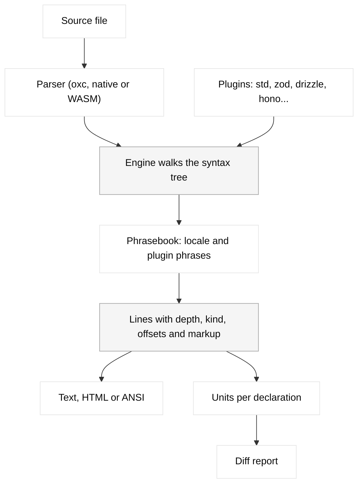

Narrator reads code the way a careful colleague would read it out loud. It parses the file into a syntax tree, walks that tree statement by statement, and asks a set of rules how to say each piece. The words themselves live in a phrasebook, so the same rules can speak more than one human language.



## The pieces

<AccordionGroup>
  <Accordion title="Source language" icon="file-code">
    A source language decides which files it can read and creates a file narrator for each one. `@usenarrator/lang-ts` is the only source language today. It handles `.ts`, `.tsx`, `.js`, `.jsx`, `.mjs` and `.cjs`, and skips `.d.ts` files. See [Adding a source language](/guides/source-languages).
  </Accordion>
  <Accordion title="Parser" icon="scan-text">
    The TypeScript language does not parse code itself. You hand it a parser: `oxcParser` uses the native oxc binding on Node and Bun, and `oxcWasmParser` wraps the WASM build for browsers. Both produce the same ESTree-shaped tree, so narration is identical. See [Embedding in your app](/guides/embedding).
  </Accordion>
  <Accordion title="Engine" icon="cpu">
    The engine walks the tree. For each call it looks for a plugin rule keyed by the callee, such as `*.filter` or `z.object`. If no rule claims the call, it falls back to generic phrasing built from the identifier names. See the [Engine API](/reference/engine).
  </Accordion>
  <Accordion title="Plugins" icon="puzzle">
    A plugin is a bundle of rules, vocabulary and phrases for one library or codebase. The built-in `std` plugin covers JavaScript itself: arrays, strings, Math, JSON, Promise, Map, Set and the console. Later plugins win when two rules match the same call. See [Plugins](/plugins/overview).
  </Accordion>
  <Accordion title="Locale and phrasebooks" icon="languages">
    A locale supplies grammar (lists, articles, plurals, possessives) and every core phrase. Each plugin ships its own phrasebook per locale, and a locale can override any plugin's phrases. See [Translating Narrator](/guides/translating).
  </Accordion>
  <Accordion title="Lines" icon="list">
    The result of narrating a file is an array of `Line` objects. Each line has an indent depth, a kind, the source offsets it describes, and text with inline [markup](/concepts/markup) that marks names, functions, types and literals.
  </Accordion>
  <Accordion title="Units and diffs" icon="git-compare">
    To compare two versions of a file, Narrator splits each version into units, one per top-level declaration, and diffs the English of matching units. See [Units and diffs](/concepts/units-and-diffs).
  </Accordion>
</AccordionGroup>

## One statement, step by step

Take this line:

{/* narrate */}
```ts
const unpaid = invoices.filter((inv) => !inv.paidAt).map((inv) => inv.id);
```

```text English
Let unpaid be invoices, after these steps:
  1. Keep only those where inv's paid at is missing
  2. Take each one's ID
```

The engine sees a variable declaration, so it uses the phrase "Let X be Y." The value is a chain of calls on one list. The `std` plugin has rules for `*.filter` and `*.map`, and because the calls form a pipeline over the same list, it reads them as numbered steps instead of one long nested phrase. The property `paidAt` is split into "paid at", and `!inv.paidAt` becomes "is missing" rather than "is not truthy", because that is what the check means in practice.

None of this involves guessing. Each of those choices is a rule you can read in the source, and a plugin can override any of them.

## Names carry a lot of meaning

Most of the meaning in real code lives in identifiers, so Narrator works hard to read them well. It splits camelCase and snake_case, expands abbreviations through a glossary, and looks at the first word to decide what kind of thing a name is.

{/* narrate */}
```ts
if (isTrialing(account) && hasPaymentMethod) {
  const nextInvoice = buildInvoice(account);
  await sendInvoiceEmail(nextInvoice);
}
```

```text English
If account is trialing and has payment method:
  Build invoice (account), and call the result next invoice.
  Send invoice email (next invoice).
```

`isTrialing` starts with "is", so it reads as a yes or no question. `buildInvoice` starts with a verb, so it reads as an action that produces something. A plugin can add its own verbs, glossary entries and acronyms through its `vocabulary` field.
